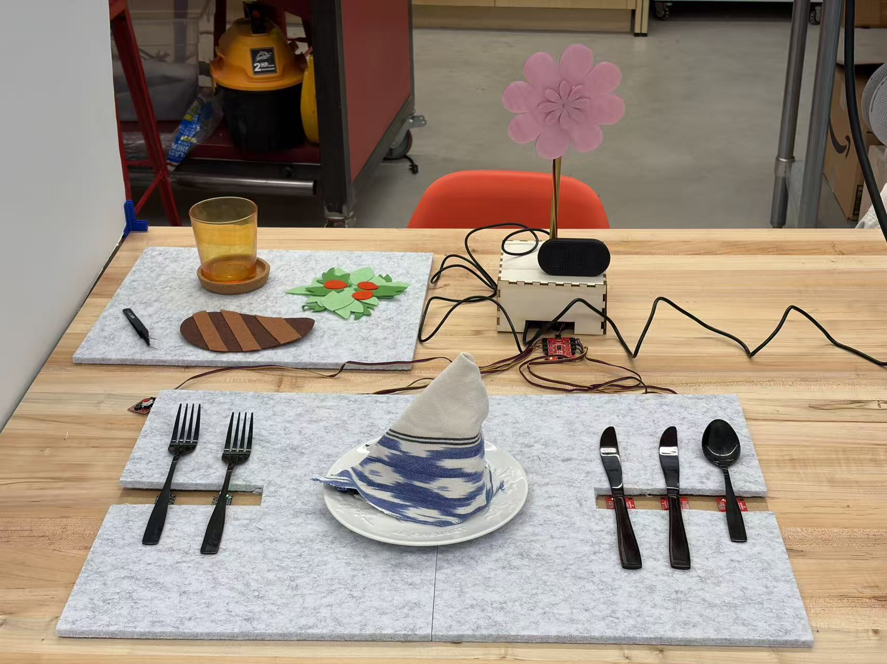
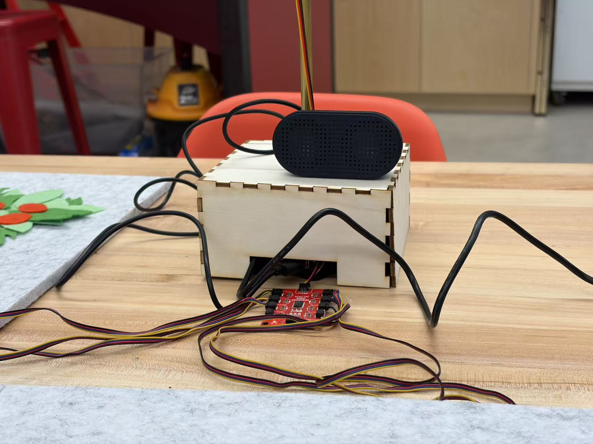
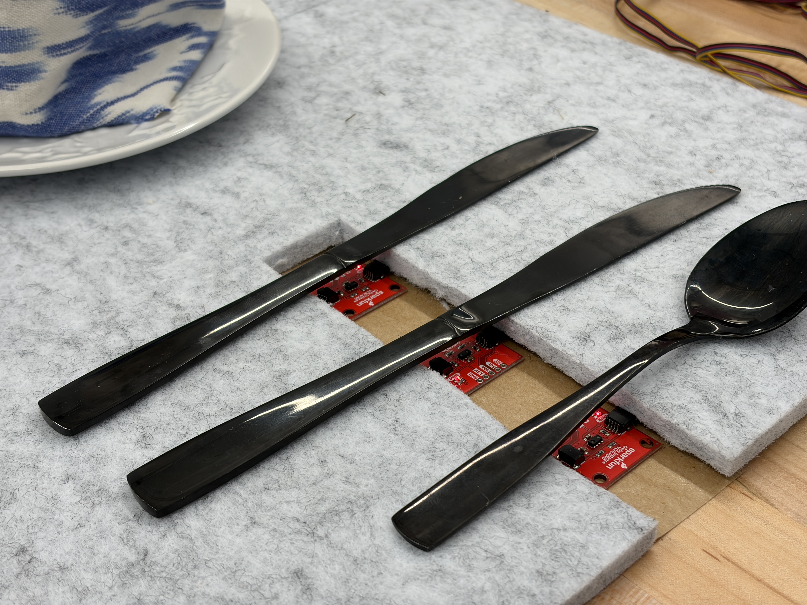
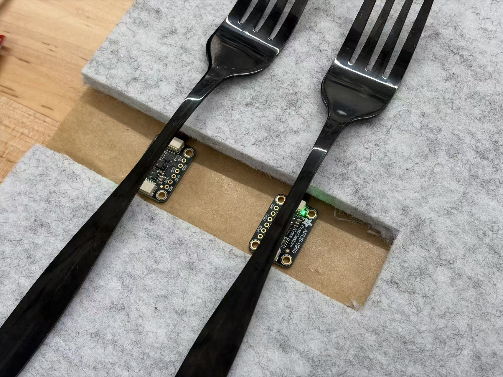
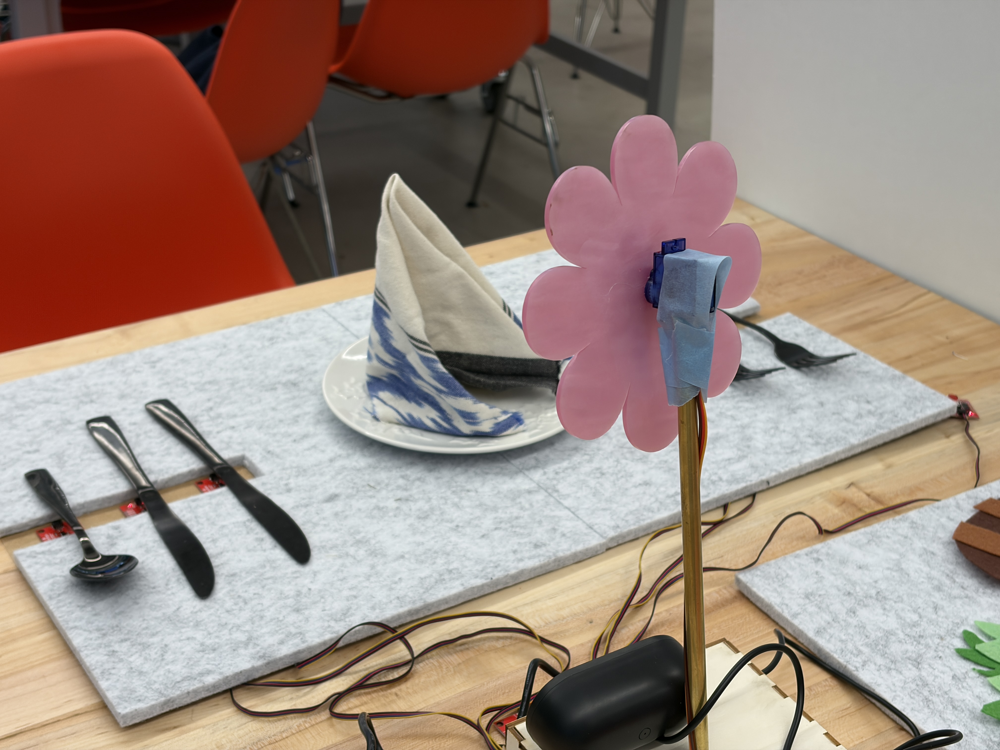

# Ph-UI!!!

# Lab Overview

**Team**: Etiquette Bouquet  

**Members**: Jianing Li(jl4837), Aurora Jiaxin Shen(js3996), Demi Hu(dh785), Tzu-Yao Chang(tc845) 

**Clock name**: Etiquette Bouquet

# Part 1

## Part D

**\*\*\*Draw 5 sketches that explore different physical arrangements for your sensing and actuation.\*\*\***

We began by individually brainstorming different ways to transform familiar dining behaviors into playful physical interactions. As a group, we developed five different Feast Automata concepts. Each concept explored a different relationship between a dining behavior, sensing method, and physical actuation.

**\*\*\*What questions do these sketches raise? What do you need to physically prototype to answer them?\*\*\***

Comparing our five ideas raised several questions about both the interaction and physical implementation:

- Which dining behavior creates the clearest and most meaningful relationship between sensing and physical feedback?
- Can the sensing interaction happen naturally without requiring users to perform an additional action just for the sensor?
- Where should sensors and actuators be placed so that they do not interfere with normal dining behavior?
- How noticeable should the physical feedback be?
- Can different servo movements communicate different meanings without additional text or screen feedback?
- How can the electronics and moving components be integrated into a tabletop object without making the dining setup feel cluttered?

For the Etiquette Flower concept specifically, we wanted to physically prototype several questions:
- Can we reliably detect when individual metal utensils are removed from the placemat using capacitive sensing?
- How large and how far apart should the sensing areas underneath the utensils be?
- Where should the flower be positioned so that its movement is visible without interfering with the meal?
- Can the flower clearly communicate two different states through a gentle nod and rapid spinning?
- How can the servos and electronics be housed inside or underneath the flower structure?

**\*\*\*Pick one design to prototype and explain why.\*\*\***

We finally picked this idea: **Etiquette Bouquet**

This concept is inspired by the conventions of Western dining etiquette, particularly the practice of selecting utensils in a particular order during a multi-course meal. For our prototype scenario, the expected sequence is soup spoon → outer fork and knife → inner fork and knife. The user selects utensils as they eat. Sensing areas underneath the placemat detect which utensil has been picked up. If the user selects the expected utensil, a small flower gently nods. If the user selects an incorrect utensil, the flower rapidly spins to provide more noticeable corrective feedback.

Sensing & actuation: Capacitive sensing underneath the utensil positions detects utensil selection. Servo-driven movements allow the flower to nod or spin in response.

We chose this concept because it transforms an existing dining convention into a playful interaction without requiring the user to learn a completely new behavior. The user simply selects utensils as they normally would, while the system responds through the movement of the flower. We were also interested in using physical movement rather than a screen or written instructions as feedback. The contrast between a gentle nod for a correct selection and rapid spinning for an incorrect selection creates two visually distinct responses while keeping the interaction playful. The concept also gave us a clear way to integrate both sensing and actuation into the physical table setting: sensing can be embedded underneath the placemat, while the flower serves as the visible actuated object.

Our intended interaction flow is:

User begins the meal
↓
User picks up a utensil
↓
The system detects which utensil was removed
↓
The Raspberry Pi compares it with the expected utensil
- Correct → Flower gently nods
- Incorrect → Flower rapidly spins
↓
The system waits for the next utensil selection

**\*\*\*Document your rough prototype with photos and/or video.\*\*\***

**Prototype Process**

We built a low-fidelity prototype to explore the overall physical arrangement of the selected concept, including the placement of the plate, utensils, sensing areas, and flower.

Our prototype helped us explore the scale and position of the flower relative to the dining setup and how the sensing areas could be integrated underneath the utensil positions.

**Final Prototype**

Our planned implementation uses capacitive sensing underneath the placemat. Separate copper-tape electrodes correspond to different utensil positions and connect to an MPR121 capacitive sensing board. The Raspberry Pi uses these signals to identify which utensil has been removed.

The flower provides the physical output. We plan to use servo-driven movement to create two different feedback behaviors:

- Correct utensil → gentle nod
- Incorrect utensil → rapid spin

We will test the sensing reliability, electrode placement, sensing thresholds, and flower mechanisms during the next stage of implementation.

We also recorded a Wizard-of-Oz demonstration of the intended interaction.

https://github.com/user-attachments/assets/50672203-766c-4e02-83a6-3138f499a55a

The video demonstrates the complete interaction sequence, including both correct and incorrect utensil selections.

> **Iteration note:** During Part E, we moved from this planned capacitive-sensing approach to individual proximity sensors. See [Part E](#part-e) for our final implementation.

---

# Part 2

---

## Part E

### Build & Integrate: Etiquette Bouquet

### Final Concept

**Etiquette Bouquet** is an interactive fine-dining companion that responds to a diner's utensil choices through movement and sound.

The system follows a simplified multi-course fine-dining sequence:

**Soup spoon → outer fork & knife for salad → inner fork & knife for the main course**

During the meal, the flower gently sways while elegant music plays, creating the atmosphere of a fine-dining table. When the diner follows the expected utensil sequence, the flower continues its graceful movement. If the diner selects the wrong utensils, the flower suddenly breaks its composure: it shakes rapidly and the elegant music is interrupted by an error sound.

The contrast between these two behaviors turns an invisible rule of dining etiquette into playful physical feedback.

---

### From Capacitive Sensing to Proximity Sensing

Our original concept in Part D used capacitive sensing underneath the placemat. During implementation, however, we moved away from this approach and instead used individual proximity sensors to detect whether each utensil was present or removed.

This gave us a more direct mapping between each physical utensil position and its sensing input.

Our final system uses **five proximity sensors**, one for each utensil position:

- 3 × VCNL4040 proximity sensors
- 2 × APDS-9960 proximity sensors

Because multiple sensors of the same type share the same I²C address, we connected them through a **Qwiic TCA9548A I²C multiplexer**. Each sensor is assigned to a separate multiplexer channel, allowing the Raspberry Pi to read all five sensors independently.

We calibrated a separate detection threshold for each sensor because the readings varied depending on the sensor type, utensil position, distance, and physical arrangement.

---

### Sensing and Interaction Logic

Each proximity sensor continuously monitors whether its corresponding utensil is resting in its expected position.

When a utensil changes from **present → absent**, the system interprets this as the diner picking it up.

The Raspberry Pi then compares the detected utensil with the expected stage of the meal:

1. **Soup:** use the soup spoon first.
2. **Salad:** use the outer fork and knife.
3. **Main course:** use the inner fork and knife.

For the fork-and-knife pairs, either utensil can be picked up first within the course. The system tracks the pair before moving on to the next stage.

To prevent small fluctuations in proximity readings from accidentally triggering an interaction, we require several consecutive sensor readings to confirm a state change.

---

### Physical Output: The Bouquet

The bouquet is driven by a servo motor connected to the Raspberry Pi through the Servo pHAT.

Rather than using a screen or written warning, we designed the bouquet itself to communicate the state of the interaction.

**Normal / correct behavior**
- Elegant background music plays.
- The bouquet moves with graceful sweeping motions.
- The movement creates a calm, formal dining atmosphere.

**Incorrect utensil selection**
- The elegant behavior is interrupted.
- The bouquet rapidly shakes from side to side.
- An error sound replaces the elegant music.
- After the reaction, the bouquet returns to its normal dining behavior.

The difference in movement, rhythm, and sound makes the error noticeable without requiring the diner to look at a display.

---

### System Architecture

Our final interaction pipeline is:

**Utensil movement**  
↓  
**5 proximity sensors**  
↓  
**Qwiic TCA9548A multiplexer**  
↓  
**Raspberry Pi**  
↓  
**Dining-sequence logic**  
↓  
**Correct / Incorrect**  
↓  
**Servo movement + audio feedback**

---

### Final Physical Prototype

The final prototype integrates the dining setup, five utensil sensing positions, the Raspberry Pi and multiplexer, and the servo-actuated bouquet into one tabletop interaction.

### Prototype Details

  
  

  
  

---

### Code

The final interaction is divided into two main Python programs:

- [`etiquette.py`](etiquette.py) — reads the five proximity sensors through the I²C multiplexer, tracks utensil state changes, and determines whether each action follows the expected dining sequence.
- [`flower.py`](flower.py) — controls the servo movement and audio feedback of the flower for correct and incorrect interactions.

This separation allowed us to develop and test the sensing logic and physical output independently before integrating them into the final interaction.

---

### Final Demo

[**Watch the final Etiquette Bloom demo →**](media/final_video.mp4)

https://github.com/user-attachments/assets/8cf8b440-7d38-4163-a596-c4daf0b51ef8

The demo shows both correct and incorrect dining sequences:

- Correct: soup spoon → outer fork & knife for salad → inner fork & knife for the main course.
- Incorrect: using the inner utensils for the salad, or using the outer utensils for the main course.

It also introduces a possible extension of the concept: using the flower as a form of ambient presence for remote dining.

---

### Reflection

The most challenging part of this prototype was making sensing, physical form, and movement work together as one interaction rather than as separate technical components.

One important lesson was that **sensor placement is part of interaction design**. Even when a proximity sensor worked reliably by itself, its readings changed when we placed it underneath a real utensil and integrated it into the table setting. We therefore had to adjust the placement and threshold of each sensor individually.

We also learned that timing and movement strongly affect how users interpret physical feedback. A slow, smooth movement felt calm and elegant, while a short and rapid side-to-side movement immediately felt like something had gone wrong. Adding sound made this contrast even clearer.

The I²C multiplexer was another important part of the implementation. Since several of our sensors shared the same I²C address, the multiplexer allowed us to treat five physical sensing locations independently without changing the natural arrangement of the utensils.

What was most fun was seeing the flower develop a kind of personality. Instead of simply displaying “correct” or “incorrect,” its movement and sound communicate the state of the interaction. The final prototype made us interested in exploring how the same physical object could communicate not only etiquette feedback, but also social presence.

---

## Part F

### Final Documentation

#### Looks Like

Etiquette Bloom is designed as a small tabletop flower that sits beside a formal dining setting.

The flower and table arrangement intentionally contrast the visible technology underneath the prototype. From the diner's perspective, the main interaction remains familiar: a plate, utensils, and a decorative flower. The sensors are positioned around the utensil locations so that the diner does not need to perform a separate action to interact with the system.

The flower serves both as a decorative centerpiece and as the primary physical output of the system.

---

#### Works Like

Etiquette Bloom senses which utensil the diner removes from the table and compares that action with the expected sequence of a multi-course meal.

Five proximity sensors monitor the five utensil positions. A Qwiic I²C multiplexer allows the Raspberry Pi to communicate with multiple sensors that share the same I²C address.

The system then maps sensing to physical and auditory feedback:

**Correct utensil**
→ elegant music + graceful flower movement

**Incorrect utensil**
→ rapid shaking + error sound

This creates a closed interaction loop:

**Diner → Utensil → Sensor → Raspberry Pi → Flower → Diner**

---

#### Acts Like

We wanted the flower to feel less like an error indicator and more like a small dining companion with its own behavior.

Normally, it maintains the atmosphere of the meal through elegant music and gentle movement. When the diner breaks the expected utensil sequence, the flower suddenly “loses its composure”: its movement becomes rapid and uneasy, and the music changes with it.

This behavioral contrast allows the diner to understand that something has gone wrong without reading instructions or checking a screen.

[**Watch Etiquette Bloom in action →**](media/final_video.mp4)

---

#### Concept Extension: Dining Together, Apart

While building Etiquette Bloom, we began to think about the flower not only as an etiquette guide, but also as an **ambient social companion**.

What if two flowers at two distant dining tables could be connected?

When a distant friend sits down to eat, the flower at the other person's table could come alive with gentle movement and music, quietly signaling:

**someone is dining with you.**

Instead of recreating a video call, this extension uses physical movement and ambient sound to represent another person's presence in a subtle way.

Our final video illustrates this concept as an extension of the current prototype. It suggests how the same language of movement and sound could move beyond etiquette feedback toward remote companionship and shared dining experiences.
