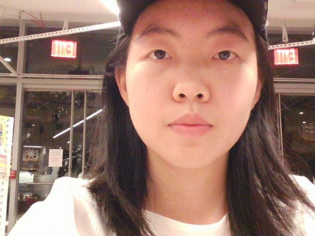
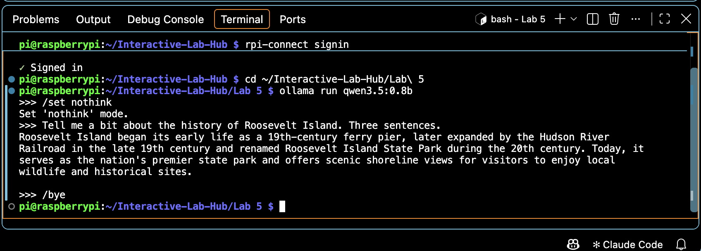
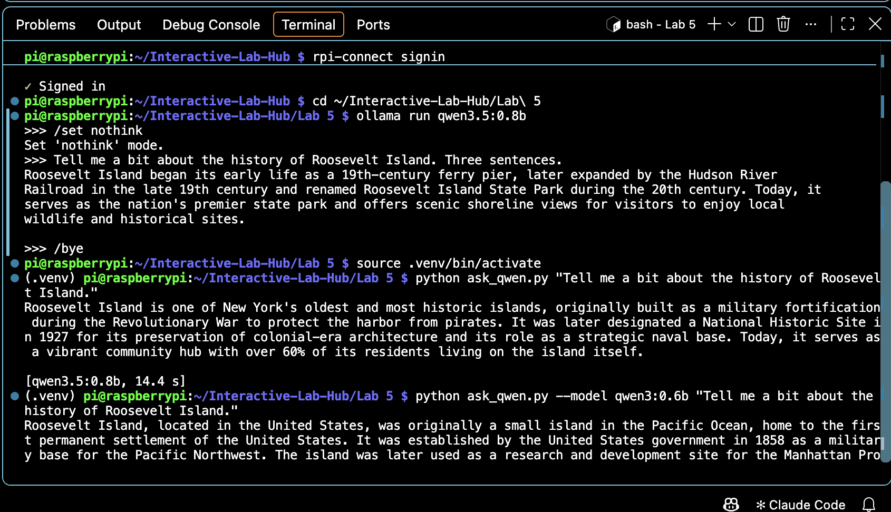

# Observant Systems: Overnight Sensation

**Team:** Individual

**Members:** Jiaxin Shen (jiaxinshen, aurorajxshen)

**Project name:** Overnight Sensation

---

# Part 1

## Part A. Set up your Pi for on-device AI

Set up a virtual environment on the Pi, installed all requirements (including `ultralytics`), exported `yolo26n` to NCNN format, installed Ollama, and pulled both models.

`ollama list` showing installed models:

YOLO `yolo26n_ncnn_model` prediction on `bus.jpg`:

YOLO prediction on `snap.jpg` (taken with `snap.py`):

## Part B. See: recognize people in real time with YOLO

[Video: yolo_person.py experiments with different confidence thresholds and `--all` flag](partb_compressed.mp4)

Three situations where it did not detect me, or detected a person who was not there:

1. *(to be filled in)*
2. *(to be filled in)*
3. *(to be filled in)*

## Part C. See more: hands and pose with MediaPipe

[Video: hand_pose.py demo — pinch-to-volume and Quiet Coyote mute gesture](partc_compressed.mp4)

How I might use face, hand, or body pose tracking in my observant system:

*(to be filled in)*

## Part D. Reason: run Qwen on the Pi with Ollama

**Q1: "Tell me a bit about the history of Roosevelt Island."**

**qwen3.5:0.8b (14.4 s):**
> Roosevelt Island is one of New York's oldest and most historic islands, originally built as a military fortification during the Revolutionary War to protect the harbor from pirates. It was later designated a National Historic Site in 1927 for its preservation of colonial-era architecture and its role as a strategic naval base. Today, it serves as a vibrant community hub with over 60% of its residents living on the island itself.

**qwen3:0.6b (13.2 s):**
> Roosevelt Island, located in the United States, was originally a small island in the Pacific Ocean, home to the first permanent settlement of the United States. It was established by the United States government in 1858 as a military base for the Pacific Northwest. The island was later used as a research and development site for the Manhattan Project.

Ground truth: Roosevelt Island was Blackwell's Island, then Welfare Island; renamed in 1973. Cornell Tech opened there in 2017. `qwen3.5:0.8b` at least placed it in New York, while `qwen3:0.6b` put it in the Pacific Ocean. Both models fabricated the historical facts.

---

**Q2: "What is in this photo?" (`--image snap.jpg`, qwen3.5:0.8b, 34.1 s)**

> A young woman wearing a black baseball cap with long dark hair appears to be taking a selfie inside what looks like a restaurant or café.

The description is broadly accurate for the photo (black cap, long hair, indoor setting).

---

**Q3: "Name two things Cornell Tech is known for." (qwen3.5:0.8b, 4.0 s)**

> Cornell Tech is known for its advanced robotics and artificial intelligence systems, as well as its focus on sustainable energy solutions.

Cornell Tech is actually best known for its Roosevelt Island campus, its ties to the NYC tech and startup ecosystem, and cross-disciplinary programs bridging engineering, business, and design. Robotics and sustainable energy are not its defining identity — the answer is generic and low confidence.

---

**Comparison:** Both models answered Q1 in roughly the same time (~13–14 s). `qwen3.5:0.8b` is more grounded (correct city) but still hallucinates. `qwen3:0.6b` made worse errors (wrong continent, wrong context). Neither should be used as a knowledge base; they are only reliable when the answer is present in the data provided to them. Note: `qwen3:0.6b` is text-only — passing `--image` returns a 400 error.

## Part E. Connect: from YOLO readings to Qwen reasoning

*(to be completed)*

---

# Lab 5 Part 2: Overnight Sensation

## Part F. Storyboard

*(to be completed)*

**Prep for Part 2 feedback and revised storyboard:**

*(to be completed)*

## Part G. Design the interaction before

*(to be completed)*

## Part H. Incorporate the observant system

*(to be completed)*

## Part I. Design the interaction after

*(to be completed)*
